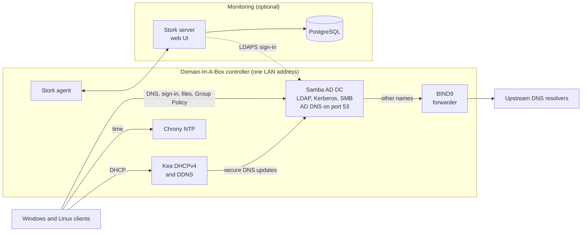

# Domain-In-A-Box

[](https://github.com/GMouzourou/Domain-In-A-Box/actions/workflows/build-and-test.yml)
[](LICENSE)
[](charts/domain-in-a-box)
[](https://github.com/GMouzourou?tab=packages&repo_name=Domain-In-A-Box)

**Your own Active Directory domain, DNS, DHCP and time server, in one
container.**

Domain-In-A-Box packages the open-source building blocks of a Windows-style
network into a single, tested deployment: a Samba Active Directory domain
controller, DNS, DHCP with dynamic DNS, NTP, and a monitoring dashboard. Run
it with Docker on one host, or on Kubernetes with the Helm chart. No Windows
Server licence is required.

## Why Domain-In-A-Box?

- **One deployment instead of five.** Directory, DNS, DHCP, time and
  monitoring are configured to work together from the first start: DHCP
  clients appear in DNS automatically, domain members get their time from the
  domain, and Kerberos authentication works out of the box.
- **Compatible with the tools you know.** Windows and Linux computers join the
  domain normally. Manage users, groups, computers and Group Policy with the
  Windows RSAT tools or `samba-tool`.
- **Secure by default.** LDAPS and HTTPS use your own certificates, and the
  Stork web UI uses your domain accounts. Insecure modes require an explicit
  opt-in.
- **Reproducible.** The configuration lives in a `.env` file or Helm values
  file, data lives on persistent volumes, and every change is tested in CI
  with DNS, DHCP, LDAP and Kerberos checks and a Linux client domain join.
- **Grows with you.** Start with a single Docker host. Move to Kubernetes when
  you want declarative installs, and try the experimental two-controller mode
  when you want to keep sign-in and DNS running through a host failure.

## Features

| Area | What you get |
| --- | --- |
| **Active Directory** | Samba AD DC: users, groups and computers, Kerberos, LDAP and LDAPS, SYSVOL and NETLOGON shares, Group Policy |
| **DNS** | AD-integrated DNS zones, with BIND9 forwarding other names to the upstream resolvers you choose |
| **Application DNS** *(opt-in)* | [ExternalDNS bridge](docs/external-dns.md): new Kubernetes Ingress names register under your domain, with dedicated credentials and ownership-safe updates |
| **DHCP** | Kea DHCPv4 with dynamic DNS: client names are registered in AD DNS using secure (GSS-TSIG) updates, without overwriting records you created |
| **Time** | Chrony NTP server for domain members |
| **Monitoring** | ISC Stork web dashboard for DHCP and DNS, signed in with your domain accounts, plus Prometheus metrics for Samba, BIND and Kea |
| **Deployment** | Docker Compose, Docker CLI or a Helm chart; `linux/amd64` images on GitHub Container Registry |
| **Redundancy** *(experimental)* | A second domain controller on another host, with one-way SYSVOL synchronization and a Kea hot-standby DHCP pair |

## Use cases

- **Home networks and homelabs:** single sign-on for family or lab computers,
  local DNS names for every device, and one place to manage it all.
- **Learning and testing:** practise Active Directory, Group Policy, Kerberos
  and DNS administration, or test software against a real domain, without
  Windows Server.
- **Small offices:** a low-cost directory and network-services server on
  modest hardware.
- **Branch and edge sites:** a self-contained services bundle that can be
  deployed and rebuilt from configuration.

## How it works

The controller runs with its own address on your LAN, so clients see it as an
ordinary domain controller, DNS server and DHCP server.



The domain keeps running if the monitoring components are unavailable.

## How it compares

| | Domain-In-A-Box | Windows Server | Separate tools (router DHCP, Pi-hole, manual Samba) |
| --- | --- | --- | --- |
| Licence cost | Free (AGPL-3.0) | Windows Server licence and CALs | Free |
| Hardware | One Linux host or an existing Kubernetes cluster | A Windows host or VM per domain controller | Several devices or services |
| Integration | DNS, DHCP, DDNS, time and monitoring configured together and tested | Integrated | You integrate and maintain each piece |
| Deployment | Configuration file and one command | Interactive installation and promotion | Individual setup for each tool |
| AD compatibility | Samba AD: covers common domain, Kerberos, LDAP and Group Policy needs | Complete | Depends on your Samba setup |
| Multi-controller redundancy | Experimental | Mature, with automatic SYSVOL replication (DFS-R) | Manual |

Samba does not implement every Windows Server feature; for example, it has no
DFS-R SYSVOL replication. If you need full Windows Server compatibility or a
production-grade multi-site directory, use Windows Server.

## Choose your deployment

| | Docker | Kubernetes | Multi-controller Kubernetes |
| --- | --- | --- | --- |
| **Status** | Supported | Supported | **Experimental** |
| **Best for** | Home networks, labs, one small site | Teams already running Kubernetes | Evaluating redundancy in a lab |
| **You need** | One Linux host with Docker | A cluster with Multus and persistent storage | Two physical nodes, node-pinned storage, two LAN addresses |
| **Domain controllers** | One | One | Two |
| **Monitoring** | Docker Compose includes Stork; Docker CLI is core-only | Stork included | Shared Stork server |
| **Survives the loss of a host** | No | No (unless storage is replicated, see below) | Sign-in, DNS and Group Policy reads continue; DHCP needs a manual step |

### Services and what to expect

| Service | Docker and Kubernetes | Multi-controller Kubernetes |
| --- | --- | --- |
| **Sign-in, directory, DNS** | Available while the controller runs. | Both controllers serve; clients use the survivor automatically when one fails. |
| **Group Policy** | Available while the controller runs. | Applied from either controller. Edits are only possible on the primary, so they are blocked while it is down. |
| **DHCP** | Available while the controller runs. Existing leases continue during an outage. | Served by the primary only. If the primary is down for longer than clients can tolerate, an operator [takes over DHCP](docs/operator-procedures.md#take-over-dhcp-on-the-secondary) on the secondary after confirming the primary is off. |
| **Time** | Available while the controller runs. | Both controllers serve time. |
| **Monitoring** | Optional. A monitoring outage never affects the other services. | Optional. A monitoring outage never affects the other services. |
| **Operator involvement** | Fix or replace the host, restore from backup if data is lost. | Rarely needed, but some steps require care: never run DHCP on both controllers, and never restore one controller from a backup. |
| **Main risks** | A single point of failure: when the controller is down, new sign-ins without cached credentials, DNS and new DHCP leases stop. | Changes held only by a controller that is destroyed before replicating are lost. Taking over DHCP while the primary is still running can cause duplicate addresses. |

Full details, including every consequence and accepted risk, are in
[Multi-controller Kubernetes](docs/multi-controller.md#service-behaviour-and-consequences).

### Disruptive events

| Event | Docker and Kubernetes | Multi-controller Kubernetes |
| --- | --- | --- |
| **A service process crashes** | Restarted automatically inside the controller. If a core service keeps failing, the controller container restarts itself. | Same, and the other controller keeps serving. |
| **Controller restart or upgrade** | Brief outage until the controller is ready again. | No interruption to sign-in or DNS; Group Policy edits and DHCP pause only while the primary restarts. |
| **Host reboot** | Outage until the host and controller are back. | The other controller keeps serving. In testing, the rebooted controller was back within about 4.5 minutes. |
| **Host permanently lost** | Domain unavailable. Rebuild from a backup ([#41](https://github.com/GMouzourou/Domain-In-A-Box/issues/41)). On Kubernetes with replicated storage, the controller can restart on another node ([#39](https://github.com/GMouzourou/Domain-In-A-Box/issues/39)). | The survivor keeps serving. Remove the lost controller and join a new one. If the primary is lost, Group Policy cannot be edited until promotion is supported ([#40](https://github.com/GMouzourou/Domain-In-A-Box/issues/40)). |
| **Network split between controllers** | Not applicable. | Both keep serving clients and resynchronize when the network recovers. |
| **Monitoring outage** | No effect on domain services. | No effect on domain services. |
| **Power cut to all hosts** | Services return with the hosts. | Services return with the hosts. Physical power-loss testing is still to do ([#42](https://github.com/GMouzourou/Domain-In-A-Box/issues/42)). |

## Quick start

On a Linux host with Docker Compose:

```bash
git clone https://github.com/GMouzourou/Domain-In-A-Box.git
cd Domain-In-A-Box
cp .env.example .env
```

1. Edit `.env`: set your domain name, the domain Administrator password, your
   host's LAN interface, the LAN addresses and a free DHCP range. The other
   service passwords are generated on first start.
2. Create certificates in `./certs`, as described in
   [Certificates](docs/certificates.md).
3. Disable any other DHCP server on the LAN, or set `DIB_DHCP_ENABLED=false`.
4. Start the stack:

   ```bash
   docker compose up -d
   ```

Point a client's DNS at the controller and join it to the domain. The Stork
dashboard is at `https://192.168.1.3/`.

The full walkthrough is in [Docker](docs/docker.md). For Kubernetes, see
[Kubernetes](docs/kubernetes.md).

## Documentation

The [manual](docs/README.md) covers:

- [Getting started](docs/getting-started.md): prerequisites and choosing a deployment
- [Networking](docs/networking.md) and [Certificates](docs/certificates.md)
- [Docker](docs/docker.md), [Kubernetes](docs/kubernetes.md) and
  [Multi-controller Kubernetes](docs/multi-controller.md)
- [Configuration reference](docs/configuration.md)
- [Operations](docs/operations.md), [Operator procedures](docs/operator-procedures.md)
  and [Troubleshooting](docs/troubleshooting.md)
- [Multi-controller design notes](docs/multi-controller-design.md)
- [Development](docs/development.md)

## Project status

Single-controller Docker and Kubernetes deployments are tested in CI on every
change: service health, DNS, DHCP leases, Active Directory queries over LDAP
and LDAPS, and an Ubuntu client domain join. Multi-controller mode has been
tested on a three-node lab cluster but is experimental. See
[Validation status](docs/multi-controller.md#validation-status) and the
[open issues](https://github.com/GMouzourou/Domain-In-A-Box/issues).

## Contributing

Bug reports, ideas and pull requests are welcome. See
[Development](docs/development.md) for how to build and test.

## Licence

Domain-In-A-Box is licensed under the
[GNU Affero General Public License v3.0](LICENSE). It builds on
[Samba](https://www.samba.org/), [BIND9](https://www.isc.org/bind/),
[Kea](https://www.isc.org/kea/), [Stork](https://www.isc.org/stork/),
[Chrony](https://chrony-project.org/) and
[PostgreSQL](https://www.postgresql.org/), each under its own licence.
